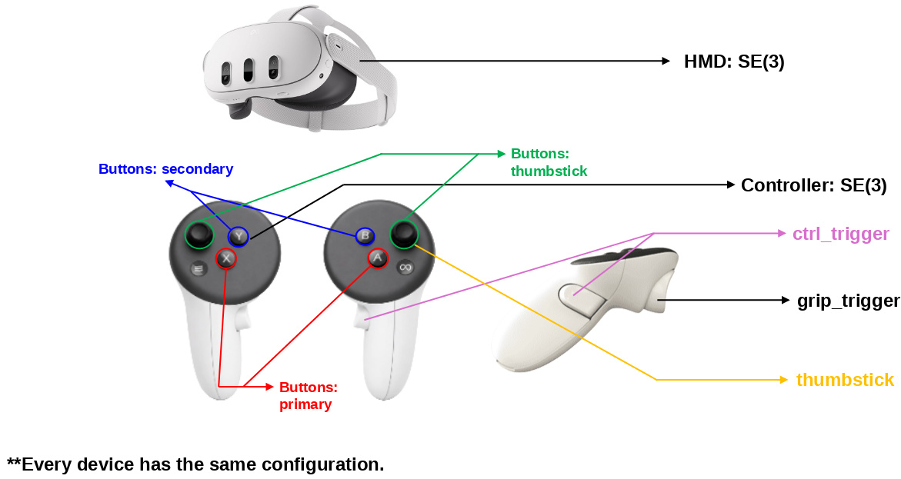
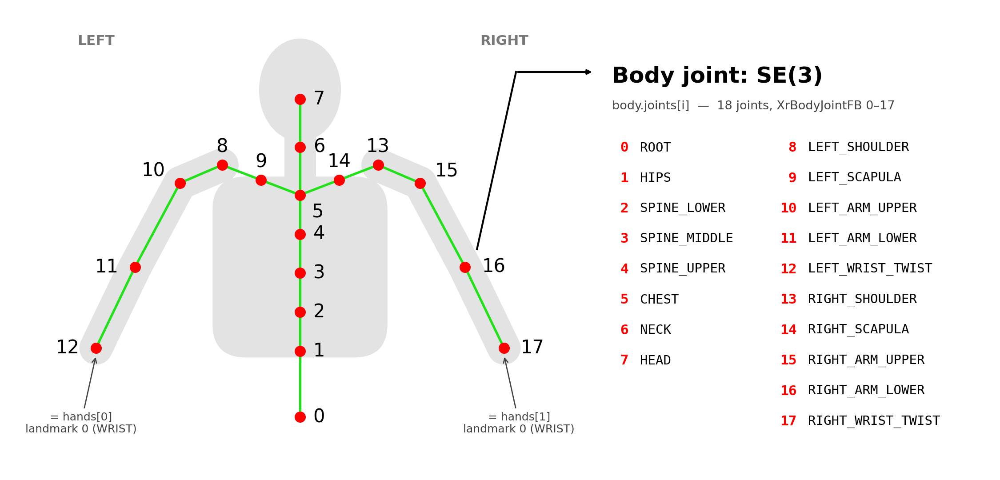

[한국어](README_KOR.md) | **English**

# Meta_for_teleoperation

**Unity app for Meta Quest (Horizon OS).** Visualizes hand tracking on top of
the passthrough view and streams the HMD, both hands (21 landmarks), both
controllers' pose/input state and the upper-body skeleton (18 joints, from
Meta's Inside-Out Body Tracking) to a PC over TCP in real time, every frame.
The headset is the server; the PC is the client.

```
Meta Quest (Unity APK)  ──TCP :5555 (NDJSON)──▶  PC (subscriber / robot control, etc.)
```

## Transport

| Item | Value |
| --- | --- |
| Protocol | **TCP server** — the headset opens the port; the PC connects to `tcp://<headset-ip>:5555` |
| Port | `5555` (configurable in the Inspector) |
| Format | **NDJSON** — one JSON object per line, `\n`-terminated, UTF-8 |
| Rate | **Every render frame** (Quest ≈ 72 Hz). Cap with `maxPublishHz > 0` (default 0 = uncapped) |
| Semantics | **Latest-value broadcast** — a background send thread writes only the most recent frame to every connected client. A slow client never stalls the stream, and broken clients are dropped automatically |
| Delivery guarantee | Frames where nothing is tracked are still published (marked `tracked: false`), never skipped |

The publisher (`PoseFramePublisher`) is already wired into the scene as the
`PosePublisher` object in `SampleScene`, so no manual setup is needed — a
freshly built APK starts streaming immediately. The required permissions
(`INTERNET`, `com.oculus.permission.HAND_TRACKING`,
`com.oculus.permission.BODY_TRACKING`) are injected into the manifest
automatically at build time.

**Receive test** (PC, standard library only):

```bash
python Tools/subscriber.py --host <headset-ip> --port 5555
```

Find the headset IP in the device's Wi-Fi settings; it must be on the same
network as the PC.

## Verifying the stream on a real headset

`Tools/skeleton_viewer.py` draws the whole published state in 3D — body skeleton,
both hands, HMD and controllers — and checks it against invariants live. Standard
library only (tkinter); no numpy, no matplotlib.

```bash
python Tools/skeleton_viewer.py --host <headset-ip> --port 5555
```

Watching the skeleton follow you proves less than it looks: a wrong quaternion
basis change or a swapped joint index still produces something that moves with
you. So the side panel tracks quantities that must be **constant** and reports
how far each one drifted (`spread`):

| Check | What a bad reading means |
| --- | --- |
| Upper arm / forearm / shoulder span | A skeleton is rigid. Growing spread while you move ⇒ those joints are not the joints we think they are |
| `body↔hand` (wrist twist ↔ hand landmark 0) | These should coincide, per SCHEMA.md. A large or erratic gap ⇒ the joint mapping or the seam claim is wrong |
| `body↔hmd`, `body↔ctrl` | Not zero, but must be **stable** — a wandering value means the sources are not in one frame |
| Quaternion norm | Must be 1.000; anything else means rotations are being corrupted on the wire |
| Arm chain A vs B | Decides empirically whether the parent order really is `CHEST → SCAPULA → SHOULDER → ARM_UPPER`, the one part of SCHEMA.md not confirmed against an OpenXR header |

Controls: left-drag orbit, wheel zoom, right-drag pan, `a` per-joint axis triads,
`r` reset, `space` pause, `q` quit.

**Test it without a headset first.** `Tools/mock_publisher.py` serves the same
wire format from a rigid animated model, so every check must read ~0 cm:

```bash
python Tools/mock_publisher.py --port 5556
python Tools/skeleton_viewer.py --host 127.0.0.1 --port 5556
```

That is your known-good baseline: all "ok" on the mock but drift on the headset
points at the device data, not the viewer. `--fault stretch|nonunit|swap` breaks
one thing on purpose so you can watch each check actually fire before trusting it.

## Data schema

One line = one frame, consisting of `timestamp` / `frame` / `hmd` /
`hands` (21 landmarks each) / `controllers` / `body` (18 upper-body joints).
Field definitions, coordinate system and omission rules:

**→ [SCHEMA.md](SCHEMA.md)**

(The schema is a **superset** of the Galaxy_with_hands repository's: every field
that repo emits is identical here, so receiver code can be reused for either
headset without any changes. `body` is the one addition — Inside-Out Body
Tracking is Quest hardware, so it has no Galaxy counterpart. A receiver written
for Galaxy simply ignores the extra key.)

## Upper body (Inside-Out Body Tracking)

`body` carries an 18-joint torso-and-arms skeleton tracked by the headset's own
cameras. It is a third independent source alongside `hands` and `controllers` —
any combination of them may be tracked in a given frame.

| Item | Value |
| --- | --- |
| Source | Horizon OS runtime, via OpenXR `XR_FB_body_tracking` |
| Fidelity | High (IOBT) requested via `XR_META_body_tracking_fidelity`; the wire reports which mode was actually granted |
| Joints | 18 — `XrBodyJointFB` indices 0–17 (torso + arms). The hand joints 18–69 are dropped because `hands` already carries them at higher fidelity |
| Permission | `com.oculus.permission.BODY_TRACKING`, requested at runtime on first use. Until the user accepts, the body publishes as `tracked: false` |
| Dependencies | **None added.** Implemented as this project's own OpenXR feature (`BodyTrackingFeature`), calling the extension directly — no Meta XR SDK |
| Toggle | `publishBody` on the `PosePublisher` object. Turning it off keeps the `body` field present as `tracked: false`, so the schema shape never changes |

Devices without body tracking simply report `body.tracked: false` forever; hands,
HMD and controllers are unaffected.

## Device mapping

Which physical input becomes which JSON field, and how the 21 hand landmarks
and the 18 upper-body joints are numbered:






## Building the APK

### Required installs (on your machine)

| Requirement | Notes |
| --- | --- |
| **Unity Editor `6000.2.12f1`** | This project's pinned version (install via Unity Hub) |
| **Android Build Support module** | Add to the editor above via the Hub. Bundles OpenJDK + Android SDK/NDK, so nothing else is needed |
| **`adb`** (Android platform-tools) | Needed to install the APK on the device and view logs (not needed for the build itself). On Ubuntu/Debian: `sudo apt install adb`. Alternatively add the copy bundled with Android Build Support (`<Editor>/Data/PlaybackEngines/AndroidPlayer/SDK/platform-tools/adb`) to your PATH |

All other project configuration (packages, scenes, XR settings, permissions)
is **included in the repo** and restores automatically when you open the
project in Unity after cloning. After the first package import, check once:
**Project Settings ▸ XR Plug-in Management ▸ Android** — the `OpenXR` loader
plus the `Hand Tracking Subsystem` + `Meta Quest Support` +
`AR Session`/`AR Camera` (Meta) +
`Meta Inside-Out Body Tracking (publisher)` features must be enabled.
(`Tools ▸ Hand Tracking Viz ▸ 3. Full Setup` enables all of them idempotently.)

### How to build

- **Editor menu**: `Build ▸ Android APK` → `Build/<productName>.apk`
- **Batch mode** (no editor UI):
  ```bash
  Unity -quit -batchmode -nographics -projectPath . \
        -buildTarget Android -executeMethod BuildAndroid.Build \
        -output Build/Meta_with_hands.apk
  ```
- **Both APKs at once** (recommended):
  ```bash
  UNITY=~/Unity/Hub/Editor/6000.2.12f1/Editor/Unity ./Tools/build_all.sh
  # → Build/Meta_with_hands.apk        (com.dongridong.metahand,       "Meta with hands")
  # → Build/Meta_with_controllers.apk  (com.dongridong.metacontroller, "Meta with controller")
  ```
  The two APKs have different package names, so they install **side by side**
  on the headset, where they appear as **Meta with hands** and
  **Meta with controller** (the `productName`; the APK file names stay
  underscored). Product identity is injected via build arguments
  (`-productName` / `-applicationIdentifier`) and restored after the build,
  so `ProjectSettings.asset` never gets dirty.

  The one **behavioural** difference is `-handVisualization off`, passed only to
  the controller build: it compiles the on-device hand skeleton/landmark
  rendering out of that APK. Hand tracking itself stays enabled, so the Quest
  runtime still switches to hands whenever a controller is put down or loses
  tracking — without this, a hand skeleton would pop up over passthrough
  mid-session in the controller app.

  **The published data is identical in both APKs.** `hands`, `controllers` and
  `body` are streamed the same way regardless of the variant (see
  [SCHEMA.md](SCHEMA.md)); `-handVisualization` only affects what is drawn on
  the headset.

### Installing on the device

1. Enable **Developer Mode** on the Quest (via the Meta Horizon mobile app),
   have `adb` ready on the PC, and connect over USB (or wireless adb).
2. With no signing key configured, a **debug signature is applied
   automatically** → no extra key is needed for sideloading.
   ```bash
   adb install -r Build/Meta_with_hands.apk
   ```
3. On first launch, allow the **hand tracking** and **body tracking** permission
   dialogs. Body tracking stays `tracked: false` until its dialog is accepted,
   then starts publishing on its own — no restart needed.

## Sister repository

The **Samsung Galaxy XR (Android XR) edition** with the same schema and
layout: `Galaxy_with_hands` (github.com/dongridong/Galaxy_with_hands).
Only the Unity XR configuration (plugins/packages) differs per device;
the transport and wire format are identical.
