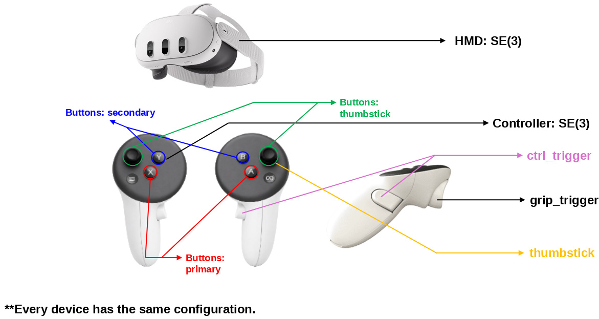

**한국어** | [English](README.md)

# Meta_for_teleoperation

**Meta Quest(Horizon OS)용 Unity 앱.** Passthrough 화면 위에 손(hand tracking)을
시각화하고, HMD·양손(21 landmark)·컨트롤러의 pose/입력 상태와 상체 스켈레톤
(18관절, Meta Inside-Out Body Tracking)을 매 프레임 TCP로 PC에 실시간
스트리밍한다. 헤드셋이 서버, PC가 클라이언트다.

```
Meta Quest (Unity APK)  ──TCP :5555 (NDJSON)──▶  PC (subscriber / 로봇 제어 등)
```

세 번째 빌드 변형은 여기에 더해 로봇의 ZED X Mini 스테레오 카메라를 WebRTC로
**수신**해 월드 고정 패널에 그린다(패스스루 대신) — [ZED 스테레오 영상](#zed-스테레오-영상-텔레오퍼레이션-빌드)
참고. 영상을 받는 동안에도 위의 TCP 스트림은 그대로 발행된다.

## 전송 방식

| 항목 | 값 |
| --- | --- |
| 프로토콜 | **TCP 서버** — 헤드셋이 포트를 열고, PC가 `tcp://<헤드셋IP>:5555`로 접속 |
| 포트 | `5555` (Inspector에서 변경 가능) |
| 포맷 | **NDJSON** — 한 줄에 JSON 1개, `\n` 종단, UTF-8 |
| 주기 | **매 렌더 프레임** (Quest ≈ 72 Hz). `maxPublishHz > 0`로 상한 설정 가능 (기본 0 = 무제한) |
| 시맨틱 | **최신값 브로드캐스트** — 백그라운드 송신 스레드가 접속한 모든 클라이언트에 가장 최근 프레임만 전송. 느린 클라이언트가 있어도 스트림이 밀리지 않고, 끊긴 클라이언트는 자동 제거 |
| 발행 보장 | 모두 미추적인 프레임도 건너뛰지 않고 발행 (`tracked: false`로 표시) |

퍼블리셔(`PoseFramePublisher`)는 `SampleScene`의 `PosePublisher` 오브젝트로 씬에
이미 배선돼 있어 수동 작업이 필요 없고, 갓 빌드한 APK가 바로 송신을 시작한다.
필요한 권한(`INTERNET`, `com.oculus.permission.HAND_TRACKING`,
`com.oculus.permission.BODY_TRACKING`)은 빌드 시 매니페스트에 자동 주입된다.

**수신 테스트** (PC, 표준 라이브러리만 사용):

```bash
python Tools/subscriber.py --host <헤드셋IP> --port 5555
```

헤드셋 IP는 기기의 Wi-Fi 설정에서 확인하고, PC와 같은 네트워크에 있어야 한다.

## 실기 스트림 검증

`Tools/skeleton_viewer.py`는 발행되는 상태 전체(상체 스켈레톤·양손·HMD·컨트롤러)를
3D로 그리면서 불변식을 실시간으로 검사한다. 표준 라이브러리(tkinter)만 쓰며 numpy·
matplotlib가 필요 없다.

```bash
python Tools/skeleton_viewer.py --host <헤드셋IP> --port 5555
```

스켈레톤이 내 움직임을 따라오는 걸 보는 것만으로는 증명되는 게 적다 — 쿼터니언 기저
변환이 틀렸거나 관절 인덱스가 뒤바뀌어도 "따라 움직이는 무언가"는 그려진다. 그래서
우측 패널은 **상수여야 하는 값**들을 추적하고 각각이 얼마나 흔들렸는지(`spread`)를
보여준다:

| 검사 | 값이 나쁘면 |
| --- | --- |
| 위팔 / 아래팔 / 어깨 너비 | 스켈레톤은 강체다. 움직이는 동안 spread가 커지면 그 두 관절이 우리가 생각한 관절이 아니라는 뜻 |
| `body↔hand` (손목 비틀림 ↔ 손 랜드마크 0) | SCHEMA.md상 같은 위치여야 한다. 크거나 들쭉날쭉하면 관절 매핑 또는 접점 주장이 틀린 것 |
| `body↔hmd`, `body↔ctrl` | 0은 아니지만 **안정적**이어야 한다. 값이 떠돌면 소스들이 같은 프레임에 있지 않다는 뜻 |
| 쿼터니언 norm | 1.000이어야 한다. 아니면 회전이 와이어에서 깨지고 있다 |
| 팔 체인 A vs B | 부모 순서가 정말 `CHEST → SCAPULA → SHOULDER → ARM_UPPER`인지 실측으로 판정 — SCHEMA.md에서 유일하게 OpenXR 헤더로 확증하지 못한 부분 |

조작: 좌드래그 궤도, 휠 줌, 우드래그 팬, `a` 관절 축, `r` 리셋, `space` 일시정지, `q` 종료.

**헤드셋 없이 먼저 시험해 볼 것.** `Tools/mock_publisher.py`가 강체 애니메이션 모델로
같은 와이어 포맷을 내보내므로, 모든 검사가 ~0 cm로 나와야 한다:

```bash
python Tools/mock_publisher.py --port 5556
python Tools/skeleton_viewer.py --host 127.0.0.1 --port 5556
```

이게 기준선이다 — 목에서는 전부 "ok"인데 실기에서 흔들린다면 원인은 뷰어가 아니라
기기 데이터 쪽이다. `--fault stretch|nonunit|swap`은 한 번에 하나씩 일부러 고장을
주입하므로, 각 검사가 실제로 발동하는지 먼저 눈으로 확인하고 신뢰하면 된다.

## 데이터 스키마

한 줄 = 한 프레임. `timestamp` / `frame` / `hmd` / `hands`(손, 21 landmark) /
`controllers`(컨트롤러) / `body`(상체 18관절)로 구성된다. 필드별 정의·좌표계·생략
규칙은:

**→ [SCHEMA_KOR.md](SCHEMA_KOR.md)**

(Galaxy_with_hands 저장소 스키마의 **상위 집합**이다 — 그쪽이 내보내는 필드는 전부
동일하므로 수신측 코드는 두 헤드셋을 구분 없이 그대로 재사용할 수 있다. 추가된 것은
`body` 하나뿐이며, Inside-Out Body Tracking은 Quest 하드웨어 기능이라 Galaxy에는
대응물이 없다. Galaxy용으로 작성된 수신기는 이 키를 그냥 무시하면 된다.)

## 상체 (Inside-Out Body Tracking)

`body`는 헤드셋 자체 카메라로 추적한 몸통·팔 18관절 스켈레톤이다. `hands`,
`controllers`와 나란히 놓인 **세 번째 독립 소스**로, 한 프레임에서 이들의 어떤
조합이든 추적 상태일 수 있다.

| 항목 | 값 |
| --- | --- |
| 소스 | Horizon OS 런타임, OpenXR `XR_FB_body_tracking` 경유 |
| 정밀도 | `XR_META_body_tracking_fidelity`로 High(IOBT) 요청. 실제로 승인된 모드가 와이어에 표시됨 |
| 관절 수 | 18 — `XrBodyJointFB` 인덱스 0–17 (몸통 + 팔). 손 관절 18–69는 `hands`가 이미 더 높은 정밀도로 싣고 있어 제외 |
| 권한 | `com.oculus.permission.BODY_TRACKING`, 최초 사용 시 런타임 요청. 사용자가 수락하기 전까지는 `tracked: false`로 발행 |
| 의존성 | **추가 없음.** 이 프로젝트 자체 OpenXR 피처(`BodyTrackingFeature`)로 확장을 직접 호출 — Meta XR SDK 미사용 |
| 토글 | `PosePublisher` 오브젝트의 `publishBody`. 꺼도 `body` 필드는 `tracked: false`로 남아 스키마 형태는 불변 |

바디 트래킹이 없는 기기에서는 `body.tracked: false`로만 나오며, 손 / HMD /
컨트롤러는 전혀 영향받지 않는다.

## 기기 매핑

어떤 물리 입력이 어떤 JSON 필드로 나가는지, 손 랜드마크 21점의 번호는 어떻게
매겨지는지:




## APK 빌드

### 필수 설치 (머신에 직접)

| 필요한 것 | 비고 |
| --- | --- |
| **Unity Editor `6000.2.12f1`** | 이 프로젝트의 고정 버전 (Unity Hub로 설치) |
| **Android Build Support 모듈** | 위 에디터에 Hub로 추가. OpenJDK + Android SDK/NDK가 번들되므로 별도 설치 불필요 |
| **`adb`** (Android platform-tools) | APK를 기기에 설치하고 로그를 보는 데 필요 (빌드 자체에는 불필요). Ubuntu/Debian은 `sudo apt install adb`. Android Build Support에 번들된 `<Editor>/Data/PlaybackEngines/AndroidPlayer/SDK/platform-tools/adb`를 PATH에 추가해 써도 된다 |

그 외 프로젝트 설정(패키지, 씬, XR 설정, 권한)은 **전부 repo에 포함**돼 있어 클론 후
Unity로 열면 자동 복원된다. 첫 오픈 시 패키지 임포트가 끝나면 한 번만 확인:
**Project Settings ▸ XR Plug-in Management ▸ Android**에서 `OpenXR` 로더와
`Hand Tracking Subsystem` + `Meta Quest Support` + `AR Session`/`AR Camera`(Meta)
+ `Meta Inside-Out Body Tracking (publisher)` 기능이 켜져 있는지.
(`Tools ▸ Hand Tracking Viz ▸ 3. Full Setup`이 이들을 멱등하게 모두 켜준다.)

### 빌드 방법

- **에디터 메뉴**: `Build ▸ Android APK` → `Build/<productName>.apk`
- **배치 모드** (에디터 UI 없이):
  ```bash
  Unity -quit -batchmode -nographics -projectPath . \
        -buildTarget Android -executeMethod BuildAndroid.Build \
        -output Build/Meta_with_hands.apk
  ```
- **세 APK 한 번에** (권장):
  ```bash
  UNITY=~/Unity/Hub/Editor/6000.2.12f1/Editor/Unity ./Tools/build_all.sh
  # → Build/Meta_with_hands.apk        (com.dongridong.metahand,       "Meta with hands")
  # → Build/Meta_with_controllers.apk  (com.dongridong.metacontroller, "Meta with controller")
  # → Build/Meta_with_zed.apk          (com.dongridong.metazed,        "Meta with ZED")
  ```
  세 APK는 패키지명이 달라 헤드셋에 **나란히 설치**되고, 앱 이름은 각각
  **Meta with hands** / **Meta with controller** / **Meta with ZED**로 표시된다
  (`productName` 기준. APK 파일명은 언더스코어 유지). 제품 정체성은 빌드 인자
  (`-productName` / `-applicationIdentifier`)로 주입되고 빌드 후 원복되므로
  `ProjectSettings.asset`은 더러워지지 않는다.

  **동작상** 유일한 차이는 컨트롤러 빌드에만 넘기는 `-handVisualization off`로,
  해당 APK에서 손 스켈레톤/랜드마크 렌더링을 컴파일 단계에서 제거한다. 손 추적
  자체는 계속 켜져 있으므로 컨트롤러를 내려놓거나 추적이 끊기면 Quest 런타임은
  여전히 손으로 전환하는데, 이 옵션이 없으면 컨트롤러 앱에서 세션 도중 패스스루
  위로 손 뼈대가 튀어나온다.

  나머지 동작 플래그는 세 번째 빌드에만 넘기는 `-videoMode zed`로, ZED 영상
  리그를 활성화해 패스스루를 로봇 카메라의 스테레오 영상으로 대체한다.

  **발행되는 데이터는 세 APK가 모두 동일하다.** `hands` / `controllers` / `body`는
  변형과 무관하게 같은 방식으로 스트리밍되며([SCHEMA_KOR.md](SCHEMA_KOR.md)),
  `-handVisualization`과 `-videoMode`는 헤드셋에 무엇을 그리는지에만 영향을 준다.
  **영상 기능으로 [SCHEMA_KOR.md](SCHEMA_KOR.md)는 바뀌지 않았다** — 와이어 포맷에
  더해진 것도 빠진 것도 없다.

### 기기에 설치

1. Quest **개발자 모드** 활성화(Meta Horizon 모바일 앱), PC에 `adb` 준비,
   USB(또는 무선 adb) 연결.
2. 서명은 키 미지정 시 **디버그 서명이 자동 적용** → sideload에 별도 키 불필요.
   ```bash
   adb install -r Build/Meta_with_hands.apk
   ```
3. 첫 실행 시 **손 추적**·**바디 트래킹** 권한 다이얼로그 허용. 바디는 다이얼로그를
   수락하기 전까지 `tracked: false`로 나오다가, 수락하면 재시작 없이 스스로
   발행을 시작한다.

## ZED 스테레오 영상 (텔레오퍼레이션 빌드)

`Meta_with_zed.apk`는 들어오는 영상 경로를 추가한다. 로봇에 달린 ZED X Mini를
Jetson이 **WebRTC(WHEP)** 로 내보내고, 이를 **월드 고정 스테레오 패널**에 그린다.
위에서 설명한 포즈·IOBT 발행은 그대로 함께 돈다 — 두 경로는 프레임 클럭 말고는
공유하는 것이 없고 어셈블리도 분리돼 있어, 영상 쪽이 죽어도 TCP 스트림은 살아 있다.

각 선택의 근거를 포함한 전체 사양은 [UNITY_PORT_PROMPT.md](UNITY_PORT_PROMPT.md)에
있다. 요약하면:

| 항목 | 값 | 이유 |
| --- | --- | --- |
| 전송 | WebRTC, WHEP 시그널링(HTTPS POST 한 번) | 안드로이드에서 RTSP는 불안정하고 HLS는 지연이 2~5초다 |
| 스트림 | SBS 3840×1200 @30fps, H.264 baseline | 한 장에 두 눈이 들어간다. baseline은 안드로이드 하드웨어 디코더 호환용 |
| 패널 | **지연 추종** — 15° 불감대 안에서는 월드 고정, 그 밖에서는 시선 쪽으로 감쇠 이동 | 카메라가 고개를 따라오지 않으므로 head-locked로 그리면 고개를 돌릴 때마다 영상이 같이 돌아 시각-전정 충돌이 난다. 불감대가 작은 머리 움직임을 진짜 월드 고정으로 지켜주고, 추종이 아예 없으면 패널이 시야를 벗어나 버린다 |
| 각크기 | `fillView` 기본 켜짐 — 양쪽 눈이 모두 온전히 볼 수 있는 최대 크기로 확대(Quest 3에서 약 1.9배). `fillView = false`면 **1:1**(카메라 1도 = 헤드셋 1도) | 1:1이 손-눈 협응을 지켜준다. 확대는 그것과 각해상도 절반을 내주고 큰 화면을 얻는 거래다 |
| 폭주면 | 실측 베이스라인과 `fx`로 계산한 HIT 시프트 | 없으면 무한원 시차가 0이라 장면 전체가 앞으로 튀어나온다 |
| 캘리브레이션 | 시작 시 Jetson의 `zedx.json`을 읽음 | 스펙 시트가 아니라 이 개체의 실측값이다 |
| 주변부 | 아주 어두운 중성 회색 + 은은한 정적 격자(월드 고정), 패널 가장자리 페더링 | 패널이 시야의 일부만 덮는데, 불편한 원인은 면적이 아니라 딱딱한 검은 사각 경계다 |

**확대에 대하여.** 카메라는 73.9°×50.4°를 보고 헤드셋은 대략 110°×96°를 보여준다.
그래서 1:1에서는 영상이 시야의 절반 남짓만 차지하고 나머지가 테두리다. `fillView`는
이를 가로로 꽉 차게(약 1.9배) 키우며, 실제로 테두리 상태로 작업하기가 불편해 기본값이다.
다만 거래 조건은 분명히 해두자 — **확대해도 세상이 더 보이지는 않는다.** 카메라 화각은
고정이라 같은 화소를 두 배의 각도에 뿌리는 것뿐이고, 물체는 실제보다 크게 보이며
디테일은 약 26 px/°에서 14 px/°로 떨어진다. 손-눈 협응이 어긋나는 느낌이거나 화면이
뭉개져 보이면 `fillView = false`로 1:1을 되찾으면 된다. 시야를 진짜로 넓히는 유일한
방법은 더 넓은 렌즈 유닛이다(지시서 부록 A).

### 실행

Jetson이 스트림을 서비스하고 있어야 하고, 헤드셋이 같은 LAN에 있어야 한다:

```bash
# Jetson에서
./zedx_webrtc.sh --xr
```

| 엔드포인트 | 용도 |
| --- | --- |
| `https://<jetson>:8443/whep` | 앱이 접속하는 곳 |
| `https://<jetson>:8443/zedx.json` | 실측 캘리브레이션. 시작 시 읽는다 |
| `https://<jetson>:8443/` | WebXR 레퍼런스 페이지 — 앱 결과를 비교할 기준 |
| `https://<jetson>:8443/timer.html` | 지연 측정용 밀리초 타이머 |

Jetson 호스트/포트는 `ZedPanelController`의 Inspector 필드다(기본
`192.168.20.131:8443`). 이 서버의 HTTPS 인증서는 자체서명이라 `UnityWebRequest`가
기본적으로, 그리고 **조용히** 거부한다. 앱은 그 호스트에 한해서만 이를 통과시킨다
(`ZedHttp`). 핸드셰이크는 몇 초 간격으로 재시도하므로 로봇보다 헤드셋을 먼저 켜도 된다.

```bash
adb install -r Build/Meta_with_zed.apk
adb logcat -s Unity | grep -E "ZedStream|PoseFramePublisher"
```

### 확인할 것

"영상이 뜬다" 이후에 봐야 할 것들:

- **좌우 순서** — 가까운 물체를 놓고 한쪽 눈씩 감아본다. 왼눈으로 볼 때 배경 대비
  **오른쪽**에 있어야 정상이다. 뒤집히면 "입체가 안 보인다"가 아니라 "보이는데
  이상하다"로 나타나서 놓치기 쉽다.
- **각크기** — `fillView = false`일 때 아는 크기의 물체가 맨눈과 같은 크기로 보여야
  한다. 켜두면 약 1.9배 크게 보이는데, 이건 버그가 아니라 그 거래의 결과다.
- **추종 동작** — 작은 머리 움직임에는 패널이 그대로 있고, 의도적으로 고개를 돌리면
  끌려오듯 따라온다(head-lock처럼 즉시가 아니라 감쇠되어 도착). 지시서 그대로의
  엄격한 월드 고정을 원하면 `ZedStereoPanel`의 `followHead`를 끈다.
- **동시 동작** — 영상이 도는 상태에서 `python3 Tools/subscriber.py --host <헤드셋IP>`가
  `body`와 `controllers`를 평소 레이트로 계속 보여줘야 한다.
- **지연** — `timer.html`을 카메라에 비추고 헤드셋 화면과 함께 촬영해 두 숫자 차이를
  WebXR 레퍼런스 페이지와 비교한다.

패널 거리·추종 파라미터(`followDeadzoneDeg`·`followSettleDeg`·`followSharpness`)·
페더링 폭·rest frame은 리그의 직렬화 필드이지 헤드셋 안의 조작 UI가 아니다.
컨트롤러 스틱은 로봇으로 발행되는 텔레오퍼레이션 입력이라, 여기서는 읽기만 하고
소비하지 않는다.

## 자매 저장소

같은 스키마·구성의 **Samsung Galaxy XR(Android XR)판**: `Galaxy_with_hands`
(github.com/dongridong/Galaxy_with_hands). Unity XR 설정(플러그인·패키지)만 기기에
맞게 다르고, 전송 방식과 와이어 포맷은 동일하다.
