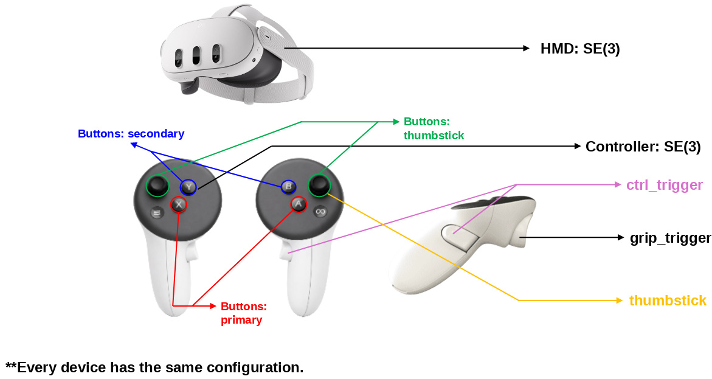
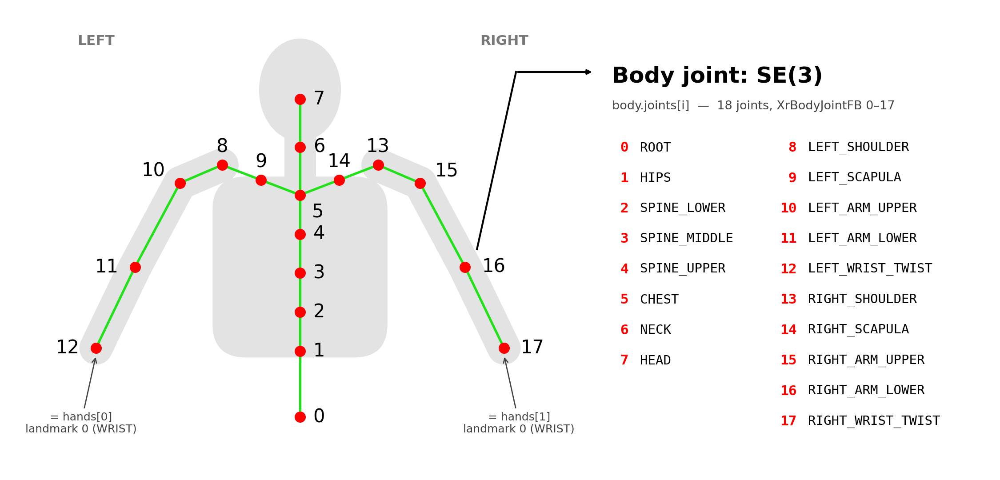

**한국어** | [English](SCHEMA.md)

# 데이터 스키마 (TCP NDJSON)

헤드셋이 송신하는 스트림의 와이어 포맷 명세.
**한 줄 = UTF-8 JSON 객체 1개 = 한 프레임** (`\n` 종단, NDJSON).

## 공통 규약

| 항목 | 값 |
| --- | --- |
| 좌표계 | `robot_world` — **오른손(RIGHT-HANDED)**, **+X 전방 / +Y 왼쪽 / +Z 위(하늘)**, 단위 **미터** (FLU: Forward-Left-Up, ROS REP-103 스타일) |
| 회전 | 쿼터니언, 배열 순서 **`[x, y, z, w]`** (⚠ `[w,x,y,z]` 아님) |
| 위치 | `[x, y, z]` |
| 숫자 포맷 | 소수점 이하 최대 6자리, 소수점은 항상 `.` (InvariantCulture) |
| 배열 순서 | `hands`, `controllers` 모두 항상 **2개 고정, `[left, right]` 순서** |

> **좌표계 변환은 송신측(퍼블리셔)이 수행한다.** 헤드셋 내부(Unity)는 왼손·Y-up
> 좌표계지만, 직렬화 시점에 아래 변환으로 오른손 FLU 프레임으로 바꿔 내보낸다:
>
> - 위치: `(x, y, z)_unity → (z, −x, y)`
> - 쿼터니언: `(x, y, z, w)_unity → (−z, x, −y, w)`
>
> **+X 전방**은 XR 트래킹 공간의 초기 정면 — 앱 시작(또는 리센터) 시점에 사용자가
> 바라보던 방향이다. 수신측(로봇 등)은 추가 변환 없이 그대로 사용하면 된다.

### 생략 규칙 (파서가 반드시 처리)

- `"tracked": false` 인 객체(hmd / 손 / 컨트롤러 / body)는 **그 아래 키가 아예 없다**
  (예: 미추적 손은 `{"side":"left","tracked":false}` 로 끝 — `palm`/`landmarks` 없음).
- `"valid": false` 인 pose(palm / landmark / grip / aim / body 관절)는
  `position`/`rotation` 이 **생략**된다 (0으로 채워지지 않음).

## 전체 예시 (실제 직렬화 순서)

```json
{
  "timestamp": 12.345,
  "frame": 1024,
  "coordinate_system": "robot_world",
  "hmd": { "tracked": true, "position": [0, 0, 1.6], "rotation": [0, 0, 0, 1] },
  "hands": [
    {
      "side": "left",
      "tracked": true,
      "palm": { "valid": true, "position": [0, 0, 0], "rotation": [0, 0, 0, 1] },
      "landmarks": [
        { "i": 0, "valid": true, "position": [0, 0, 0], "rotation": [0, 0, 0, 1] }
        /* … 21개, i = 0..20 … */
      ]
    },
    { "side": "right", "tracked": false }
  ],
  "controllers": [
    {
      "side": "left",
      "tracked": true,
      "controller": { "valid": true, "position": [0, 0, 0], "rotation": [0, 0, 0, 1] },
      "grip_trigger": 0.85,
      "ctrl_trigger": 0.12,
      "thumbstick": [0.0, -0.7],
      "buttons": { "primary": false, "secondary": false, "menu": false, "thumbstick": false }
    },
    { "side": "right", "tracked": false }
  ],
  "body": {
    "tracked": true,
    "fidelity": "high",
    "confidence": 0.97,
    "joints": [
      { "i": 0, "valid": true, "position": [0, 0, 0], "rotation": [0, 0, 0, 1] }
      /* … 18개, i = 0..17 … */
    ]
  }
}
```

- `timestamp` — 앱 시작 후 경과 초 (double).
- `frame` — 캡처 시점의 렌더 프레임 번호 (int).

## `hmd`

| 필드 | 타입 | 설명 |
| --- | --- | --- |
| `tracked` | bool | false면 아래 두 필드 생략 |
| `position` | [x,y,z] | 헤드셋 위치 (m) |
| `rotation` | [x,y,z,w] | 헤드셋 회전 |

---

## `hands` — 손 (hand tracking)


항상 2개, `[left, right]`. 각 요소:

| 필드 | 타입 | 설명 |
| --- | --- | --- |
| `side` | `"left"` \| `"right"` | 어느 손인지 |
| `tracked` | bool | false면 이하 전부 생략 |
| `palm` | pose | 손바닥 중앙 pose. `{valid, position, rotation}` |
| `landmarks` | 배열(21) | 21개 랜드마크, 아래 표 순서 고정 |

- **`palm` 정의**: OpenXR `Palm` 관절을 우선 사용. 런타임이 제공하지 않으면
  위치 = `midpoint(Wrist, MiddleProximal)`, 회전 = Wrist 회전으로 대체.
- 각 landmark 요소는 `{ "i": <0..20>, "valid": bool, "position": …, "rotation": … }`.
  관절 하나가 그 프레임에 누락되면 그 요소만 `{"i": n, "valid": false}`.

### 랜드마크 순서 (MediaPipe 21점 표준)

| i | 이름 | ← OpenXR 관절 | i | 이름 | ← OpenXR 관절 |
|---|---|---|---|---|---|
| 0 | WRIST | Wrist | 11 | MIDDLE_DIP | MiddleDistal |
| 1 | THUMB_CMC | ThumbMetacarpal | 12 | MIDDLE_TIP | MiddleTip |
| 2 | THUMB_MCP | ThumbProximal | 13 | RING_MCP | RingProximal |
| 3 | THUMB_IP | ThumbDistal | 14 | RING_PIP | RingIntermediate |
| 4 | THUMB_TIP | ThumbTip | 15 | RING_DIP | RingDistal |
| 5 | INDEX_MCP | IndexProximal | 16 | RING_TIP | RingTip |
| 6 | INDEX_PIP | IndexIntermediate | 17 | PINKY_MCP | LittleProximal |
| 7 | INDEX_DIP | IndexDistal | 18 | PINKY_PIP | LittleIntermediate |
| 8 | INDEX_TIP | IndexTip | 19 | PINKY_DIP | LittleDistal |
| 9 | MIDDLE_MCP | MiddleProximal | 20 | PINKY_TIP | LittleTip |
| 10 | MIDDLE_PIP | MiddleIntermediate | | | |

(OpenXR 26관절 중 MediaPipe에 대응하는 21개만 사용. 검지~새끼의 Metacarpal과
Palm 관절은 랜드마크에서 제외 — palm은 별도 필드로 제공.)

---

## `controllers` — 컨트롤러



*그림의 각 물리 입력에 붙은 이름이 곧 발행되는 JSON 필드명이다. `grip_trigger`가
검지(전면) 트리거, `ctrl_trigger`가 그립(측면) 트리거임에 주의 — 아래 대응표
참고. 지원 기기 모두 동일한 배치를 따른다.*

항상 2개, `[left, right]`. **`hands`와 완전히 독립된 소스**로, 모드 전환이 아니다.
한 프레임에 손·컨트롤러가 **둘 다 / 하나만 / 둘 다 아님** 모두 가능하며,
수신측이 `tracked`인 쪽을 골라 쓰면 된다.

각 요소 (tracked=true일 때, 직렬화 순서대로):

| 필드 | 타입 | 설명 |
| --- | --- | --- |
| `side` | `"left"` \| `"right"` | 어느 손 컨트롤러인지 |
| `tracked` | bool | false면 이하 전부 생략 |
| `controller` | pose | **컨트롤러 손잡이의 6DoF pose** (hands의 palm에 대응) |
| `grip_trigger` | float 0..1 | **검지(전면) 트리거** — 그리퍼 제어 입력으로 사용 |
| `ctrl_trigger` | float 0..1 | **그립(측면) 트리거** 아날로그 |
| `thumbstick` | [x, y] | 각 축 -1..1 |
| `buttons` | 객체 | `{primary, secondary, menu, thumbstick}` 모두 bool |

- `buttons.primary` = A/X, `buttons.secondary` = B/Y, `buttons.thumbstick` = 스틱 클릭.

### ⚠ 필드 이름은 용도 기준 — 물리 입력과의 대응

필드 이름은 OpenXR 명명이 아니라 **텔레옵 용도 기준**이다. `grip_trigger`는
"그리퍼(gripper)를 조작하는 트리거"라는 역할 이름이지, 하드웨어의 그립 버튼이 아니다:

| JSON 필드 | 물리 입력 | OpenXR path |
| --- | --- | --- |
| `controller` | 손잡이 pose | `/input/grip/pose` |
| `grip_trigger` | **검지(전면) 트리거** | `/input/trigger/value` |
| `ctrl_trigger` | **그립(측면) 트리거** | `/input/squeeze/value` |

### tracked / valid 판정 규칙

- **`controller` pose 획득 실패 → 컨트롤러 전체가 `tracked: false`** (손잡이 pose가
  없으면 추종할 대상이 없으므로).
- 인터랙션 프로파일에 없는 입력(스틱 등)은 `0` / `false`로 채워진다.
- 앱 설정으로 컨트롤러 샘플링을 꺼도(`publishControllers = false`) `controllers`
  필드는 사라지지 않고 양쪽 모두 `tracked: false`로 나온다 — **스키마 형태는 항상 동일**.

---

## `body` — 상체 스켈레톤 (Inside-Out Body Tracking)



*각 관절에 붙은 번호가 곧 `body.joints`의 인덱스 `i`다. 그림은 뒤에서 본 모습이라
착용자의 왼팔이 왼쪽에 온다. 관절 위치는 실측이 아닌 개략도다.*

배열이 아니라 객체 1개 (몸은 하나뿐이므로). `controllers`와 마찬가지로 **완전히
독립된 소스**다 — 한 프레임에서 손은 미추적인데 몸만 추적될 수도, 그 반대도,
둘 다이거나 둘 다 아닐 수도 있다.

관절값은 Meta의 **Inside-Out Body Tracking (IOBT)** — 헤드셋 카메라가 사용자의
실제 상체와 팔을 관측해 얻은 것이다. 추정 자체는 Horizon OS 런타임이 수행하고,
앱은 이를 켜고(OpenXR `XR_FB_body_tracking`) 고정밀 모드를 요청할
뿐이다(`XR_META_body_tracking_fidelity`).

| 필드 | 타입 | 설명 |
| --- | --- | --- |
| `tracked` | bool | false면 이하 전부 생략 |
| `fidelity` | `"high"` \| `"low"` \| `"unspecified"` | 이 관절값을 만든 트래킹 모드 — 아래 참고 |
| `confidence` | float 0..1 | 런타임이 보고하는 자세 신뢰도 |
| `joints` | 배열(18) | 상체 18관절, 아래 표 순서 고정 |

- 각 관절 요소는 `{ "i": <0..17>, "valid": bool, "position": …, "rotation": … }`.
  관절 하나가 그 프레임에 누락되면 그 요소만 `{"i": n, "valid": false}` —
  손 랜드마크와 동일한 규칙.

### `fidelity` — 팔 값을 얼마나 믿을지

| 값 | 의미 |
| --- | --- |
| `"high"` | **IOBT.** 런타임이 고정밀 요청을 수락 — 팔이 헤드셋 카메라로 실제 추적됨 |
| `"low"` | 런타임이 고정밀을 거부. 상체를 HMD·컨트롤러 pose로부터 *추정* — 특히 팔꿈치가 훨씬 부정확 |
| `"unspecified"` | `XR_META_body_tracking_fidelity` 미지원이라 런타임 기본 모드가 적용됨 (최신 Horizon OS의 Quest 3 / 3S에서는 이미 IOBT) |

### 관절 순서 (OpenXR `XrBodyJointFB` 0–17)

| i | 이름 | i | 이름 |
|---|---|---|---|
| 0 | ROOT | 9 | LEFT_SCAPULA |
| 1 | HIPS | 10 | LEFT_ARM_UPPER |
| 2 | SPINE_LOWER | 11 | LEFT_ARM_LOWER |
| 3 | SPINE_MIDDLE | 12 | LEFT_WRIST_TWIST |
| 4 | SPINE_UPPER | 13 | RIGHT_SHOULDER |
| 5 | CHEST | 14 | RIGHT_SCAPULA |
| 6 | NECK | 15 | RIGHT_ARM_UPPER |
| 7 | HEAD | 16 | RIGHT_ARM_LOWER |
| 8 | LEFT_SHOULDER | 17 | RIGHT_WRIST_TWIST |

**왜 70개가 아니라 18개인가.** `XR_FB_body_tracking`의 기본 관절 집합은 70개지만,
번호가 몸통·팔 먼저(0–17), 양손이 그 뒤(18–69)로 매겨져 있다. 손은 이미 전용 핸드
트래킹 서브시스템에서 더 높은 정밀도로 `hands`에 실려 나가므로 18–69는 버린다 —
프레임이 작게 유지되고 `body`와 `hands` 사이에 **중복이 전혀 없다**.

따라서 이 스켈레톤은 손목 비틀림 관절(12 / 17)에서 끝나며, 이 지점이 해당 손
랜드마크 0번(`WRIST`)과 같은 위치다 — 두 스켈레톤이 이어지는 접점이다.

### 스켈레톤 계층

수신측이 스켈레톤을 그리거나 리깅할 때 쓰는 부모 → 자식 관계:

```
0 ROOT → 1 HIPS → 2 SPINE_LOWER → 3 SPINE_MIDDLE → 4 SPINE_UPPER → 5 CHEST
5 CHEST → 6 NECK → 7 HEAD
5 CHEST → 9 LEFT_SCAPULA  → 8 LEFT_SHOULDER  → 10 LEFT_ARM_UPPER  → 11 LEFT_ARM_LOWER  → 12 LEFT_WRIST_TWIST
5 CHEST → 14 RIGHT_SCAPULA → 13 RIGHT_SHOULDER → 15 RIGHT_ARM_UPPER → 16 RIGHT_ARM_LOWER → 17 RIGHT_WRIST_TWIST
```

### tracked / valid 판정 규칙

- 바디 트래킹은 **`com.oculus.permission.BODY_TRACKING`** 런타임 권한이 필요하다.
  사용자가 동의 팝업을 수락하기 전까지는 `tracked: false`로 발행되며, 수락되면
  재시작 없이 스스로 값을 내보내기 시작한다 (앱이 1초에 한 번 재시도).
- 바디 트래킹이 없는 헤드셋·런타임에서는 항상 `tracked: false`로만 나온다 —
  손 / HMD / 컨트롤러는 전혀 영향받지 않는다.
- 앱 설정으로 바디 샘플링을 꺼도(`publishBody = false`) `body` 필드는 사라지지 않고
  `tracked: false`로 나온다 — **스키마 형태는 항상 동일**.

---

## 파싱 분기 요약

| 조건 | 출력 | 주의 |
| --- | --- | --- |
| HMD 미추적 | `"hmd": {"tracked": false}` | `position`/`rotation` 키 없음 |
| 손 미추적 | `{"side": …, "tracked": false}` | `palm`/`landmarks` 키 없음 |
| palm/landmark `valid:false` | `{"valid": false}` / `{"i": n, "valid": false}` | `position`/`rotation` 키 없음 |
| 컨트롤러 미추적 | `{"side": …, "tracked": false}` | `controller` 이하 전부 키 없음 |
| body 미추적 | `"body": {"tracked": false}` | `fidelity`/`confidence`/`joints` 키 없음 |
| body 관절 `valid:false` | `{"i": n, "valid": false}` | `position`/`rotation` 키 없음 |
